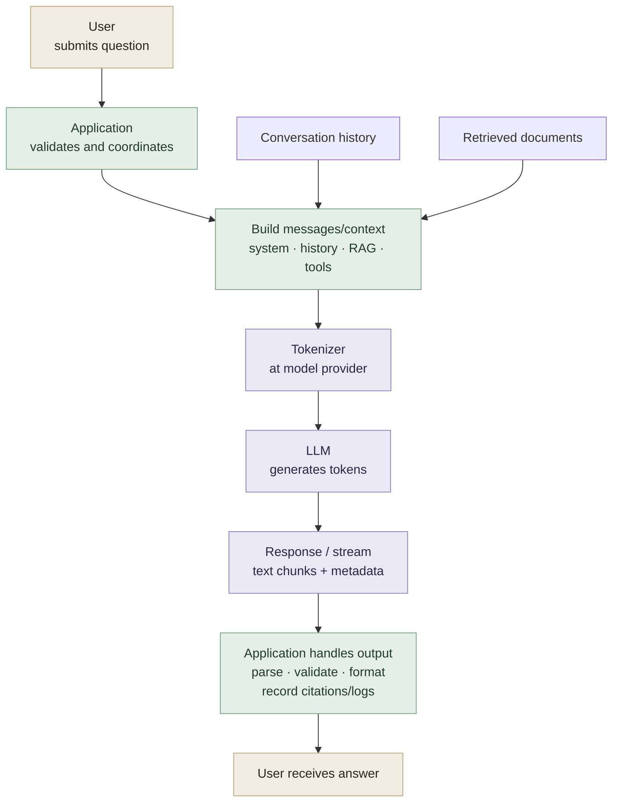

## Learning objectives

Explain how an LLM generates text, distinguish tokens from words, and recognize limitations such as hallucination and knowledge cutoffs.

## Prerequisites

No machine learning experience is required. You should be familiar with sending requests to a chat application.

## Theory: from text to tokens

A **large language model (LLM)** is a neural network trained on text to process and generate language. Many LLMs generate text autoregressively: predict a distribution for the next token from the current context, select a token using a decoding strategy, and repeat. This is a common account of text generation, rather than a definition covering every LLM architecture or task. [OpenAI: Key concepts](https://platform.openai.com/docs/introduction#key-concepts)

A token is not the same as a word. A rare word may split into several tokens; punctuation, whitespace, and Vietnamese characters also affect tokenization. Context length and API cost are therefore commonly measured in tokens rather than words.

The **context window** is the number of tokens a model can consider in one processing step; limits and input/output accounting depend on the model and API. System instructions, conversation history, retrieved documents, and the answer may share a token budget. Longer context does not automatically improve answers: redundant information can obscure relevant signals.

An LLM is not a database that guarantees exact answers. It can produce plausible but incorrect statements (**hallucinations**), reason poorly without sufficient evidence, or lack information newer than its training or provided sources. For reliable tasks, verify outputs with sources, tools, or an evaluation process.

## Architecture in an application



The diagram shows that the **tokenizer usually runs at the model provider**, rather than being a UI step the user explicitly invokes in every application. The application validates inputs, selects context, sets limits, and processes model output before responding. Safety and correctness should not be delegated entirely to the model.

## TypeScript example: estimating a context budget

```ts
type ContextBudget = {
  windowTokens: number;
  reservedOutputTokens: number;
  systemTokens: number;
  historyTokens: number;
  retrievedTokens: number;
};

function remainingInput(budget: ContextBudget): number {
  const used = budget.reservedOutputTokens + budget.systemTokens
    + budget.historyTokens + budget.retrievedTokens;
  return Math.max(0, budget.windowTokens - used);
}
```

This calculation uses measured or estimated token counts; the actual tokenizer must match the selected model.

## Practice

1. Choose a customer-support task and list the context needed for an accurate answer.
2. Write one verifiable answer and one question that might cause an LLM to guess.
3. Estimate a budget for system instructions, five conversation turns, three document passages, and the output.

## Common mistakes

- Assuming one token equals one word or that every language has the same token ratio.
- Treating fluent answers as proof of correctness.
- Forgetting to reserve output space when adding conversation history.
- Sending all history and documents without filtering for the task.

## Further reading

- \* Essential — [OpenAI: Tokenizer](https://platform.openai.com/tokenizer)
- [OpenAI: Context windows](https://help.openai.com/en/articles/8554397-creating-a-gpt)

## Quick quiz

1. Why is “one token equals one word” an incorrect assumption?
2. Which parts of a request usually consume the context window?
3. Which application controls can reduce hallucination risks?

## Completion criteria

Explain token prediction, calculate a simple context budget, and identify two ways to verify an answer beyond judging how confident it sounds.
