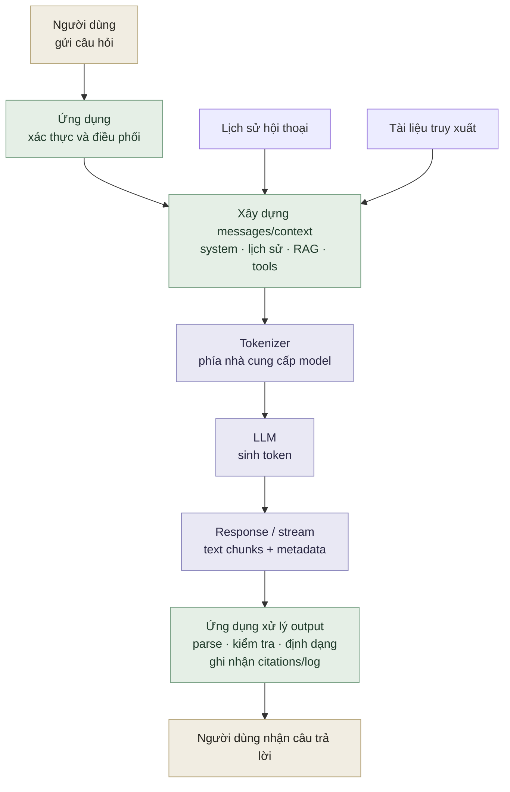

## Mục tiêu học tập

Sau bài học, bạn có thể giải thích LLM tạo văn bản như thế nào, phân biệt token với từ, và nhận diện những giới hạn quan trọng như hallucination và knowledge cutoff.

## Điều kiện tiên quyết

Không cần kinh nghiệm về machine learning. Chỉ cần quen với việc gửi yêu cầu đến một ứng dụng chat.

## Lý thuyết: từ văn bản đến token

**Large language model (LLM)** là một neural network được huấn luyện trên dữ liệu văn bản để xử lý và tạo ngôn ngữ. Nhiều LLM tạo văn bản theo kiểu autoregressive: dự đoán phân phối cho token tiếp theo dựa trên context hiện có, chọn token theo decoding strategy, rồi lặp lại. Đây là mô tả phổ biến về text generation, không phải định nghĩa bao quát mọi kiến trúc hoặc tác vụ của LLM. [OpenAI: Key concepts](https://platform.openai.com/docs/introduction#key-concepts)

Token không đồng nghĩa với từ. Một từ hiếm có thể bị chia thành nhiều token; dấu câu, khoảng trắng và ký tự tiếng Việt cũng ảnh hưởng đến cách chia. Vì vậy, độ dài ngữ cảnh và chi phí API thường được tính bằng token, không phải số từ.

**Context window** là lượng token mà model có thể xem xét trong một lần xử lý; giới hạn và cách tính input/output phụ thuộc model/API. Hướng dẫn hệ thống, lịch sử hội thoại, tài liệu truy xuất và câu trả lời có thể cùng tiêu thụ token budget. Context dài hơn không tự động giúp câu trả lời tốt hơn: thông tin thừa có thể làm tín hiệu quan trọng khó được chú ý.

LLM không phải cơ sở dữ liệu có thể truy vấn chính xác. Mô hình có thể tạo câu nghe hợp lý nhưng sai (**hallucination**), suy luận yếu khi thiếu dữ kiện, hoặc không biết thông tin mới hơn dữ liệu/nguồn được cung cấp. Với tác vụ cần độ tin cậy, hãy kiểm tra kết quả bằng nguồn, công cụ hoặc quy trình đánh giá.

## Kiến trúc trong một ứng dụng



Sơ đồ cho thấy **tokenizer thường nằm phía nhà cung cấp model**, không phải một bước giao diện mà người dùng tự gọi trong mọi ứng dụng. Ứng dụng chịu trách nhiệm xác thực đầu vào, chọn nội dung cần đưa vào context, đặt giới hạn, rồi xử lý kết quả model trước khi trả lời. Không nên giao toàn bộ trách nhiệm an toàn hay tính đúng đắn cho mô hình.

## Ví dụ TypeScript: ước lượng ngân sách context

```ts
type ContextBudget = {
  windowTokens: number;
  reservedOutputTokens: number;
  systemTokens: number;
  historyTokens: number;
  retrievedTokens: number;
};

function remainingInput(budget: ContextBudget): number {
  const used = budget.reservedOutputTokens + budget.systemTokens
    + budget.historyTokens + budget.retrievedTokens;
  return Math.max(0, budget.windowTokens - used);
}
```

Đây là phép tính ngân sách dựa trên số token đã đo/ước lượng; tokenizer thực tế cần khớp với model đang dùng.

## Thực hành

1. Chọn một tác vụ hỗ trợ khách hàng và liệt kê thông tin nào phải có trong context để trả lời chính xác.
2. Viết một câu trả lời có thể kiểm chứng và một câu hỏi mà LLM có nguy cơ đoán mò.
3. Ước lượng ngân sách cho system prompt, 5 lượt hội thoại, 3 đoạn tài liệu và đầu ra.

## Lỗi thường gặp

- Cho rằng token tương ứng một từ hoặc mọi ngôn ngữ có cùng tỷ lệ token.
- Xem câu trả lời trôi chảy là bằng chứng cho tính đúng.
- Quên dành chỗ cho output khi đưa lịch sử vào context.
- Gửi toàn bộ lịch sử/tài liệu mà không lọc theo tác vụ.

## Đọc thêm

- [OpenAI: Tokenizer](https://platform.openai.com/tokenizer)
- [OpenAI: Context windows](https://help.openai.com/en/articles/8554397-creating-a-gpt)

## Câu hỏi phỏng vấn

Câu hỏi luyện tập tự biên soạn từ các nguồn gốc bên dưới, kiểm chứng ngày 2026-11-07. Đây là bài tập ôn phỏng vấn, không phải câu hỏi được xác nhận từ một nhà tuyển dụng cụ thể. Đáp án thiết kế gợi ý một cách tiếp cận có cơ sở. Dấu \* Essential thể hiện mức ưu tiên biên tập; ôn câu này trước các câu tiếp theo.

### 1. \* Essential — Causal language model dự đoán gì?

**Vì sao cần ưu tiên:** Dự đoán token giải thích khả năng sinh văn bản và sai sót có vẻ hợp lý.

**Gợi ý trả lời:** Phân phối xác suất của token tiếp theo dựa trên các token trước đó. Token có thể chỉ là một phần của từ; văn bản trôi chảy chưa chứng minh thông tin đúng.

Nguồn kiểm chứng: [Causal language modeling](https://huggingface.co/docs/transformers/tasks/language_modeling).

### 2. Vì sao self-attention quan trọng?

**Gợi ý trả lời:** Nó kết hợp thông tin giữa các vị trí để tạo biểu diễn theo ngữ cảnh. Giải thích vai trò query, key, value và phân biệt Transformer gốc với các biến thể decoder-only hiện nay.

Nguồn kiểm chứng: [Attention Is All You Need](https://arxiv.org/abs/1706.03762).

### 3. Model tự bịa chính sách nội bộ. Bạn xử lý thế nào?

**Gợi ý trả lời:** Truy xuất chính sách có thẩm quyền, đưa đoạn liên quan vào context và yêu cầu dẫn chứng hoặc nói rõ chưa biết. Đổi prompt không cập nhật trọng số model.

Nguồn kiểm chứng: [OpenAI prompt engineering](https://developers.openai.com/api/docs/guides/prompt-engineering).

### Tài nguyên ôn phỏng vấn

- \* Essential — [Causal language modeling](https://huggingface.co/docs/transformers/tasks/language_modeling): đọc trước để kiểm chứng khái niệm cốt lõi trước câu hỏi thiết kế.

- [Transformers](https://github.com/huggingface/transformers): Upstream và repo mẫu: đọc định nghĩa model và ví dụ language modeling; ví dụ huấn luyện dùng Python.

## Quiz nhanh

1. Vì sao “1 token = 1 từ” là giả định sai?
2. Những phần nào thường tiêu thụ context window?
3. Hallucination có thể được giảm rủi ro bằng những kiểm soát nào trong ứng dụng?

## Tiêu chí hoàn thành

Bạn hoàn thành bài khi giải thích được quy trình dự đoán token, tính được ngân sách context đơn giản, và nêu được hai cách kiểm chứng đầu ra ngoài việc đọc độ tự tin của câu chữ.
