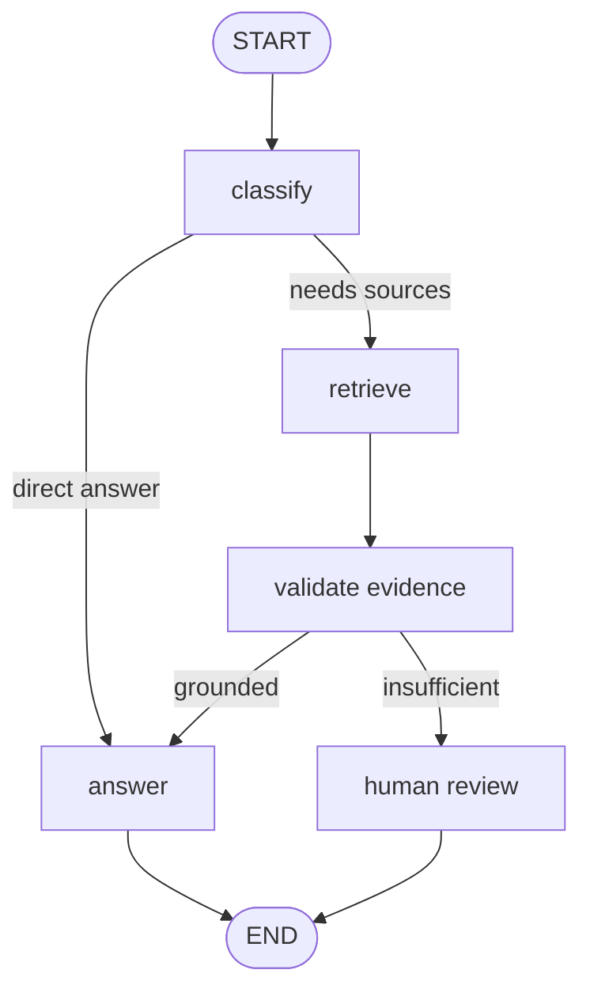

## Learning objectives

Design typed state, draw a bounded graph, and prevent uncontrolled loops or undefined routes.

## Prerequisites

Complete the prerequisite lesson: [langchain-js](/learn/langchain-js). If you already know this material, use the practice questions to assess your understanding.

## Theory

LangGraph represents workflows as graphs with shared state. Nodes perform small steps, edges choose subsequent steps, and conditional routing branches on state. An explicit graph supports retries, human review, and transition tests. Design termination conditions before adding an agent loop.

## Architecture

START → classify → route to answer, retrieval, or approval → validate → END; state passes through nodes under a defined schema.



## TypeScript example

```ts
type State = { question: string; route: "retrieve" | "answer"; attempts: number };
function route(state: State) { return state.attempts > 2 ? "answer" : state.route; }
```

This snippet illustrates boundaries and data types. Before production use, add validation, error handling, and permissions appropriate to the use case.

## Practice

Draw a question-answering workflow with retrieval, insufficient-evidence, and escalation branches. Specify termination conditions and valid state transitions.

## Common mistakes

Building confusing graphs with oversized nodes; non-exhaustive conditional routing; forgetting retry limits.

## Further reading

- \* Essential — [Primary resource](<https://docs.langchain.com/oss/javascript/langgraph/overview>)

## Interview questions

Original practice questions based on the primary references below, checked on 2026-11-07. These are preparation exercises, not verified questions from a particular employer. Design answers suggest one defensible approach. The literal \* Essential marker indicates editorial priority; start there before the follow-up questions.

### 1. \* Essential — What do state, nodes, and edges represent?

**Why essential:** Explicit state and termination conditions prevent uncontrolled execution.

**Answer outline:** State carries workflow data, nodes compute updates, and edges determine execution order or conditional routing. Define valid transitions and an explicit terminal outcome.

Reference: [LangGraph Graph API](https://docs.langchain.com/oss/javascript/langgraph/graph-api).

### 2. How do you choose a fixed workflow over an agent loop?

**Answer outline:** Use fixed paths when the process is known and auditable. Use model-driven routing where inputs require judgment, with validated decisions and bounded iterations.

Reference: [LangGraph workflows and agents](https://docs.langchain.com/oss/javascript/langgraph/workflows-agents).

### 3. Two parallel nodes update the same field. What must be defined?

**Answer outline:** Specify merge semantics with an appropriate reducer, or avoid conflicting writes. Test ordering assumptions; appending data differs from replacing a value.

Reference: [LangGraph Graph API](https://docs.langchain.com/oss/javascript/langgraph/graph-api).

### Interview resources

- \* Essential — [LangGraph Graph API](https://docs.langchain.com/oss/javascript/langgraph/graph-api): read first to verify the core concept before the design exercises.

- [LangGraph.js](https://github.com/langchain-ai/langgraphjs): Upstream and sample repository: use the examples to explore state, routing, and recovery.

## Quick quiz

What are nodes and edges responsible for? Name two ways to ensure the graph terminates.

## Completion criteria

You can test each transition and show every branch reaches END or an explicit waiting state.
