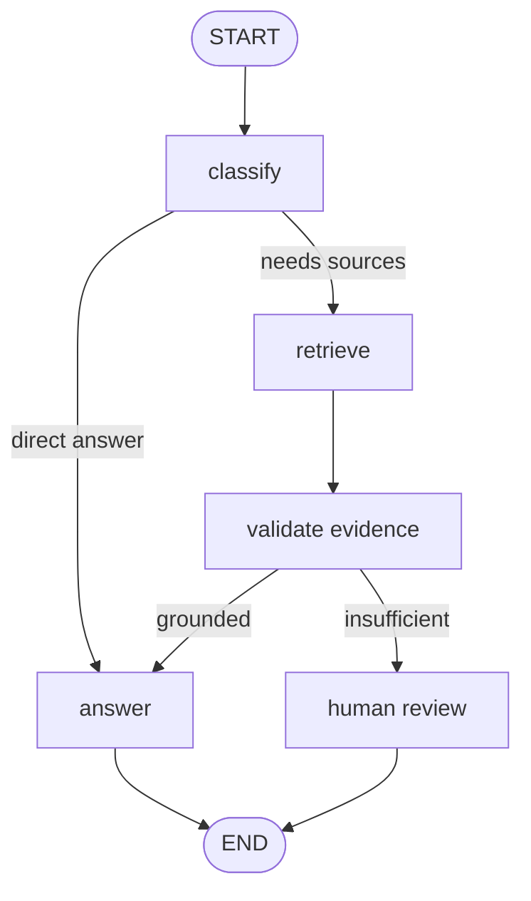

## Mục tiêu học tập

Thiết kế state có kiểu; vẽ graph hữu hạn; chặn vòng lặp và route không xác định.

## Điều kiện tiên quyết

Hoàn thành bài liên quan trước đó: [langchain-js](/learn/langchain-js). Nếu đã biết phần này, hãy dùng câu hỏi thực hành để tự đánh giá.

## Lý thuyết

LangGraph biểu diễn quy trình như graph có state dùng chung. Node thực hiện bước nhỏ; edge xác định bước tiếp; conditional routing chọn nhánh dựa trên state. Graph rõ ràng hỗ trợ retry, human review và test từng chuyển trạng thái. Thiết kế termination condition trước khi thêm agent loop.

## Kiến trúc

START → classify → route: answer / retrieve / request approval → validate → END; state đi qua từng node với schema kiểm soát.



## Ví dụ TypeScript

```ts
type State = { question: string; route: "retrieve" | "answer"; attempts: number };
function route(state: State) { return state.attempts > 2 ? "answer" : state.route; }
```

Đây là đoạn minh họa ranh giới/kiểu dữ liệu; trước production cần bổ sung validation, error handling và quyền phù hợp với use case.

## Thực hành

Vẽ workflow trả lời câu hỏi có nhánh cần truy xuất, thiếu dữ liệu, và escalation. Ghi điều kiện termination cùng state transition hợp lệ.

## Lỗi thường gặp

Tạo graph khó hiểu với node khổng lồ; conditional route không exhaustive; quên giới hạn số lần retry.

## Đọc thêm

- [Tài liệu gốc](<https://docs.langchain.com/oss/javascript/langgraph/overview>)

## Quiz nhanh

Node và edge có trách nhiệm gì? Nêu hai cách bảo đảm graph dừng.

## Tiêu chí hoàn thành

Bạn có thể kiểm tra từng transition và chứng minh mọi nhánh đạt END hoặc trạng thái chờ rõ ràng.
